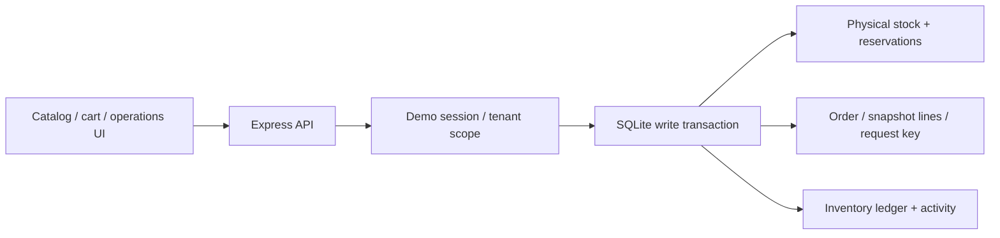

# Stockade architecture

JavaScript ES modules run on Node and in the browser. Express hosts both API and static assets; SQLite is the durable relational store. The local app binds to loopback. An opaque cookie maps to a seeded account and business; request parameters do not grant tenant access. Host, Origin, and custom write-header checks protect the local demo boundary. Demo account selection is explicitly not real identity verification.

## Conservation before convenience

The central invariant is `onHand >= reserved >= 0`, with available stock derived from those values. Checkout locks the write transaction before reading and changing stock, allocates all lines or none, and snapshots catalog prices. Failed checkout cannot leave half a cart reserved. A process-local mutex is insufficient because two API processes must coordinate through storage.

Successful local payment leaves the hold in place; shipping consumes both physical stock and the hold. Cancellation, expiry, or decline release the hold exactly once. Refund follows shipping and may restock once. State transitions and ledger/activity writes share the transaction. Repeated commands are checked against persisted state rather than trusting a disabled button.

Inventory adjustments require the observed product version. A stale operator sees a conflict instead of replacing a concurrent reservation change. Database constraints are the last boundary; service validation should turn predictable business conflicts into readable responses before they become generic SQL errors.

## Idempotency is stored intent

Each checkout has a tenant-scoped key and normalized intent fingerprint. Same key and same intent returns the same order; changed intent conflicts. The replay contains the current order state rather than freezing the first JSON response. A replay after cancellation must not resurrect stock holds. Allocation and key persistence commit together, so a lost HTTP response can be retried safely.

Payments here are deliberately simulated in the same database transaction. This avoids claiming that local SQL can atomically commit a real remote charge. A real provider would require a stable provider key, an uncertainty state, reconciliation, and carefully separated retries. Relay's sibling rebuild studies that external-effect gap directly.

## Expiry and clocks

Reservation expiry is a persisted deadline, not an in-memory timer attached to one process. The running server sweeps overdue holds, and transition logic checks deadlines before allowing actions. Tests can inject a clock so boundary assertions do not depend on waiting five minutes. A paid order is not an unpaid reservation and must not expire through that path.

## What the contention result means

Two processes share one SQLite database using WAL and bounded lock waiting. The test accounts for all 500 requests: accepted orders, sold-out conflicts, and any unexpected errors. It checks final stock and duplicate keys, then restarts a process to verify persistence. The measured local elapsed time is evidence for this run, not a forecast of cloud latency or maximum throughput.

Synchronous database calls simplify transactional code but block each Node event loop. PostgreSQL, asynchronous I/O, pagination, real identity, tax, fulfillment integrations, and payment reconciliation are sensible later exercises. Add them in response to concrete requirements, with tests that preserve the original conservation promises.
