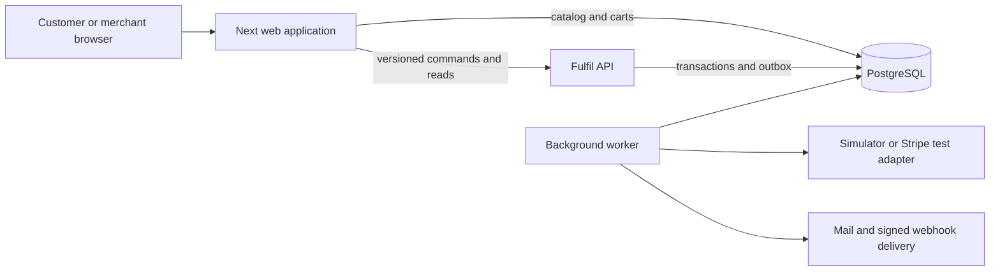

# Stockade: full project summary

## Purpose and current delivery

Stockade is a multi-merchant e-commerce order-management application. A customer browses a catalog, persists a cart, checks out, follows orders, and requests returns or exchanges. A merchant manages stock across warehouses, fulfillment, promotions, refunds, procurement, transfers, counts, and integration recovery.

The implementation uses a Next.js/React/TypeScript web application, a .NET Fulfil service, and PostgreSQL. It is a working local teaching project with real database transactions and simulator payment effects. It is not a certified production payment, tax, purchasing, or logistics system.

The work delivered three connected outputs: the preserved [unified engineering/mentorship prompt](../STOCKADE_MASTER_PROMPT.md), the executable application for both phases, and product/engineering/upskilling documentation. Real merchant discovery and independent human assessment were not performed.

## Users and their boundaries

| Actor | Main work | Boundary to understand |
|---|---|---|
| Customer or guest | Cart, checkout, own order history, eligible return/exchange requests | Client-provided IDs and totals are untrusted; ownership is checked on the server |
| Owner/administrator | Catalog, policies, order resolution, transfers, purchasing, count decisions, integrations | Command-specific role and state guards apply |
| Warehouse operator | Warehouse-scoped operational work | Assigned warehouse scope must be enforced below the UI |
| Support | Permitted order views and return decisions | Receiving returned goods uses the operations role boundary; a visible screen is not authority to execute every command |
| API client | Explicitly scoped server-to-server operations | Hashed bearer credentials can be revoked and cannot impersonate unrestricted customer checkout |

Northline is seeded with four warehouses and eight variants. Harbor has separate merchant accounts for isolation exercises. Existing local orders include synthetic verification activity; test variants were deactivated after verification without deleting ledger or order history.

## Phase 1 implementation

| Capability | Delivered behavior | Main implementation |
|---|---|---|
| Storefront and catalog | Browse/search/category selection, variant cards, product details, responsive layout | [Storefront](../src/components/Storefront.tsx), [catalog route](../src/app/api/catalog/route.ts) |
| Persistent cart | PostgreSQL-backed cart; success shown only after a successful save; reload persistence | [cart route](../src/app/api/cart/route.ts), [origin validation](../src/lib/origin.ts) |
| Checkout and inventory | Server prices and tax; non-mutating quote; reviewed total; multi-warehouse allocation and reservation | [Commerce](../services/Fulfil/Services/Commerce.cs) |
| Payment recovery | Durable intent, authorization/capture/void/refund, pending/unknown handling and manual recovery | [Worker](../services/Fulfil/Services/Worker.cs), [Payments](../services/Fulfil/Services/Payments.cs) |
| Order operations | Guarded states, partial fulfillment, cancellation, offline-warehouse reallocation and timeline | [Rules](../services/Fulfil/Domain/Rules.cs), [order detail](../src/components/OrderDetail.tsx) |
| Promotions | Percent/fixed/BOGO/shipping actions; product scope, segments, dates, caps, priority, stacking and exclusions | [Pricing](../services/Fulfil/Services/Pricing.cs) |
| Refunds and returns | Captured-fund limits, reserved refund capacity, original price/tax snapshots and one-time restock | [Commerce](../services/Fulfil/Services/Commerce.cs) |
| Integrations | Scoped API keys, signed callbacks, durable outbox, retry/dead-letter processing and TypeScript SDK | [Integrations](../services/Fulfil/Services/Integrations.cs), [SDK](../src/lib/stockade-sdk.ts) |
| Operations | Audit history, reconciliation, schema upgrades, Docker configuration, CI and runbooks | [Data](../services/Fulfil/Data), [Reconciliation](../services/Fulfil/Services/Reconciliation.cs), [CI](../.github/workflows/ci.yml) |

## Phase 2 implementation

The [feature brief and twelve stories](../docs/PHASE_2_STORIES.md) group the extension into four epics. Their user measures are proposed pilot targets with no measured merchant baseline.

| Epic | Implemented workflow | Critical rule | Evidence boundary |
|---|---|---|---|
| F1: warehouse transfers | Request, approval/hold, dispatch, partial receipt, cancellation before dispatch, explicit transit loss, owner and next action | Source + destination + outstanding transit + documented loss conserves units; transit is not sellable | Functional integration covers hold/movement, partial/duplicate receipt, loss and reconciliation; not every UI/error permutation |
| F2: supplier purchasing | Supplier records, explainable replenishment suggestions, PO draft/approval, accepted and rejected goods, partial receipt and remainder cancellation | Expected supply is not onHand; accepted receipt and ledger entry commit together | Functional integration covers partial/duplicate/over-receipt/cancel; live supplier acceptance is outside scope |
| F3: cycle counts | Baseline/version, assignment, observation, stale rejection, independent approval/rejection and corrective adjustment | Counts cannot silently overwrite newer stock or reduce onHand below commitments | Stale baseline and self-approval checks passed; broader role/warehouse variations remain useful exercises |
| F4: customer self-service | Order ownership, return eligibility, request/decision/receipt, original refund and reviewed replacement purchase | Claimed quantity cannot exceed eligible fulfillment; refund and replacement charge are separate durable workflows | Final API tests cover return/restock and exchange quote/confirmation; browser suite does not prove the entire financial journey |

These workflows are implemented in [Operations](../services/Fulfil/Services/Operations.cs), Commerce, Worker, [Admin](../src/components/Admin.tsx), [Panels](../src/components/Panels.tsx), and OrderDetail.

## Ownership and request flow

Next owns catalog/cart HTTP behavior. Fulfil owns inventory, pricing snapshots, orders, payment recovery, procurement, logistics, and returns. The shared database does not erase those ownership boundaries. The current local database account is shared for development; separate production runtime permissions are an open gate.

A command usually follows this path:

1. The browser submits an intent with a stable idempotency key.
2. The Next proxy forwards the request; Fulfil validates the session/key, merchant, actor, and operation.
3. Admission bounds competing work before opening a serializable snapshot.
4. The command checks current state, updates workflow and ledger, appends audit/outbox records, and stores its receipt in the transaction.
5. A retry with the same key and payload returns the recorded result. A mismatched payload conflicts.
6. The worker performs external effects outside the stock transaction, then persists their authoritative outcome.

See [Transactions](../services/Fulfil/Data/Transactions.cs) and [Admission](../services/Fulfil/Data/Admission.cs). Admission has not established the required throughput; it complements database constraints and transaction retries.

## Data model and invariants

[Models](../services/Fulfil/Domain/Models.cs) defines merchant-owned records. [StockadeDb](../services/Fulfil/Data/StockadeDb.cs) defines keys, indexes, checks, and selected composite relationships. [Schema](../services/Fulfil/Data/Schema.cs) and [Migrations](../services/Fulfil/Data/Migrations.cs) implement the current startup schema/versioning approach, including append-only history triggers.

| Invariant family | What must remain true | How to investigate |
|---|---|---|
| INV-1, INV-2: stock and reservations | available = onHand - reserved - held; every term and available stays nonnegative; a unit is not both reserved and held | Inspect database checks, reservation lifecycle, worker conversion and expiry |
| INV-3: history | Physical changes have append-only adjustments; corrections add history | Reconstruct onHand and compare to inventory |
| INV-4, INV-5: order/payment | Legal transitions only; fulfillment requires confirmed capture; uncertainty retains commitments | Follow Rules, payment attempts and worker recovery |
| INV-6: money/returns | refunded + refundPending <= captured; eligible return quantity and restock are bounded | Race refund requests; replay receipts |
| INV-7, INV-8: pricing/history | Server totals are authoritative and historical money facts are immutable snapshots | Change a current price and verify an old return value |
| INV-9: isolation | Every reference and action preserves actor/merchant/warehouse scope | Try a foreign ID through HTTP and inspect unchanged persisted records |
| INV-10: events | Duplicate/delayed delivery must not duplicate consumer effects | Inspect outbox origin, signature verification and durable deduplication |
| Phase 2 extensions | Transit and supplier expectations are not sellable; corrections cannot erase commitments | Include transfers and receipts in reconciliation |

A database row check does not prove agreement among inventory, reservations, transfers, and adjustments. That requires transactional workflow rules plus reconciliation and concurrent tests.

## Deliberate policies and tradeoffs

- Money is integer USD minor units; tax uses basis points and explicit rounding. The configured flat tax is a teaching policy, not jurisdictional tax compliance.
- The persisted cart is not a guarantee of inventory. Availability is revalidated at checkout.
- Orders preserve price, discount and tax facts. Cumulative allocation prevents losing or inventing cents across partial returns.
- Promotion usage is consumed by accepted checkout reservation, including attempts later declined, cancelled or refunded. Quote evaluation consumes no usage. Guest identity does not establish strong abuse prevention.
- Returns use a 30-day order-age policy and fulfilled-minus-claimed eligibility. Product teams should review whether order creation is the desired window origin.
- An exchange request reserves no replacement stock. The received return enables a separately quoted and confirmed purchase, with a separate original refund.
- PO approval is local approval; no supplier order is transmitted. Rejected goods do not become sellable stock.
- Outbox delivery is at least once. A crash after remote acceptance but before the sent marker can repeat delivery; consumers deduplicate.
- API key/webhook creation endpoints are outside command-receipt idempotency. After an uncertain creation response, inspect and revoke an orphan before replacing it.
- Source layout includes broad command/service files and generic JSON inputs. Typed boundaries, smaller feature modules and focused tests are useful future refactors after correctness evidence, not reasons to rewrite working flows first.

## Verification and limits

The [verification record](../docs/VERIFICATION.md) is authoritative for the preceding implementation run:

| Check | Observed result |
|---|---|
| Backend Release domain/security suite | 27 passed |
| Frontend unit suite | Five passed |
| Final optimized Next build and TypeScript | Passed |
| Real-PostgreSQL functional suite | 13 functional groups passed |
| Isolated production Chrome journeys | Three passed: cart/keyboard, merchant inventory/transfer form, mobile fit |
| PowerShell startup parsing and Compose configuration | Passed |
| 500 requests against 100 units | Failed/incomplete: first retry exhaustion, then client header timeout |
| Stripe account-backed flows and full production workload | Not established |

The latest contention run did not yield the required 100 accepted and 400 sold-out responses. A later snapshot was onHand 100, reserved 2, held 20, available 78 for its fixture. This preserved nonnegative counters at that instant; it did not pass the load requirement. Root cause remains unresolved, including the role of local resources, queueing, database round trips, retries, and worker interaction.

The browser suite passed in isolation after its inventory-data assertion timed out during concurrent load. It proves those functional journeys with the declared waits, not responsiveness under contention or comprehensive accessibility.

The older integration-results artifact represents an earlier 12-check pass. The final-verification artifact is an explicitly labeled summary of observed tool output. The runner was subsequently changed to write fresh failure reports and syntax-checked; that reporting change was not another full database run.

## Operations and release boundary

Use [root setup](../README.md), [runbook](../docs/RUNBOOK.md), [security notes](../docs/SECURITY.md), and [performance protocol](../docs/PERFORMANCE.md). Preserve the database and Data Protection key ring together when planning recovery. Full container execution, target restore/migration drills, least-privilege runtime roles, independent security review, provider-backed evidence, and measured resource budgets remain open.

The performance protocol retains 5,000 simultaneous attempts, 20 hot variants with 100 units each, 200,000 variants, three million historical orders, four warehouses, two application instances and one PostgreSQL instance. Required p95 values are below 800 ms for full successful checkout and below 300 ms for admin lists. These are unverified targets, not measured achievements.

## What the engineer should own next

First establish a reproducible baseline and diagnose the smaller contention failure. Then prove recovery/provider/permission boundaries before a public release. In parallel, build your own evidence through prediction, code tracing, meaningful tests, a bounded unfamiliar extension and independent review. The [next-steps backlog](NEXT_STEPS.md) and [roadmap](SWE_ROADMAP.md) make those activities concrete.

## AstraDocs handoff change
The documentation pass aligned the TypeScript SDK cancellation input with the reason required by captured-order cancellation. It is a type-contract correction, not a payment/runtime workflow change. Consult the appended verification entry for this pass; the earlier test counts above are carried-forward evidence.
