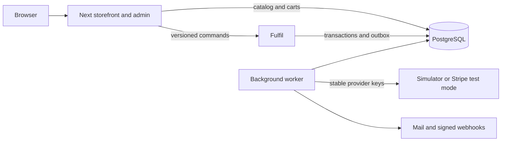

# Architecture decisions
## Ownership
Next owns catalog/cart HTTP writes. Fulfil owns orders, inventory, pricing snapshots, payment recovery, logistics, purchasing and returns. PostgreSQL is authoritative. Catalog availability is a read model; Next never changes the inventory ledger.

Checkout accepts IDs/quantities and loads current prices on the server. The quote executes in a repeatable-read transaction that is rolled back without saving. Confirmation supplies expectedTotal; changed pricing requires renewed review.

## Inventory and transactions
available = onHand - reserved - held. Database constraints prohibit negative terms and negative availability. Checkout increases reserved; capture moves reserved into held; shipment reduces held and physical onHand and appends a negative adjustment. Cancellation releases commitments.

Transfer approval adds a typed transfer allocation to held. Dispatch removes the held commitment and physical source stock. Outstanding transit = dispatched - received - explicit loss. Neither transit nor expected supplier goods are sellable. Accepted receipts append stock once in the same transaction as their workflow update.

Serializable transactions retry conflicts with bounded jitter. Idempotency receipts atomically bind merchant, actor, operation and payload digest to the result. Replaying the same key/payload returns the result; changed payload conflicts. A disabled browser button is not a concurrency control.

## Payment saga
No database transaction stays open during a provider request. A worker leases one order, records intent, calls the provider with a stable ID-derived key, and persists the outcome. Timeouts remain unknown; stock stays committed until authoritative reconciliation establishes capture or void.

Refund requests reserve financial capacity: refunded + refundPending <= captured. Only confirmed refunds move pending capacity into refunded. Provider event signatures wake reconciliation rather than directly inventing financial state. The adapter rejects live Stripe secrets.

## Money and promotion policy
All values are integer USD minor units. Tax uses basis points and half-up rounding per discounted line. Cumulative allocation keeps every discount cent on eligible merchandise. Original line/tax snapshots determine returns despite later catalog changes.

Promotions default to exclusive. Up to five codes may combine only when all allow stacking and no exclusion matches. Apply ascending priority then ordinal code against remaining merchandise; minimum conditions use the currently discounted cart. Percent, fixed, BOGO and shipping actions support product scope, new/returning segments, dates and global/per-customer caps. BOGO credits original variant unit price for each pair, capped by the remaining eligible value. Rule inputs/version are snapshotted on the order. Guest identities do not provide strong promotion-abuse prevention.

Exchanges use a received original return and a separately confirmed replacement purchase. Original refund and new charge remain independently visible. No replacement stock is held merely by requesting an exchange; confirmation rechecks availability and price.

## Purchasing and counts
Fulfil owns purchasing so accepted receipts join the same stock boundary. Approval is local and does not transmit a supplier purchase. Suggestions use available stock, confirmed supplier outstanding and destination transit; draft/cancelled quantities are excluded. Suggestions never create POs.

Counts allow stock movement but reject a changed inventory version at submission or approval. A second administrator approves corrections. A shortage below commitments requires resolution/reallocation and recount; history is not overwritten.

## Integrations
Domain events enter a transactional outbox. Parent events fan out durable signed webhook deliveries. Backoff and dead letters make failures visible. Delivery is at least once; recipients must deduplicate event IDs. A crash after SMTP/HTTP acceptance but before the sent marker can repeat delivery.

API keys are high-entropy random tokens stored only as hashes with explicit scopes. Webhook secrets are protected using the durable ASP.NET Data Protection key ring. HTTPS destinations must resolve to public addresses, connect to the validated address and reject redirects.

## Learning contract
The user authorized immediate implementation of both phases. Agent-written implementation is DELEGATE evidence; human SOLO work, explain-back and independent review remain unassessed.

## Contention remediation
The first 500-request test exhausted serializable retries (30 accepted, 470 server errors). Commands now acquire bounded in-process admission by product/promotion/record stripe, plus ordered PostgreSQL session locks before opening the transaction snapshot. This coordinates API replicas without spending connections on all queued requests. Serializable transactions and constraints remain the correctness boundary, including workers and overlapping workflows. Inventory is loaded in one allocation query. Ordinary checkout no longer scans customer order history when no segment rule needs it. Per-retry EF stack dumps are suppressed; final failures remain logged. Throughput targets still require measurement.

## Service flow

Promotion usage is consumed by an accepted checkout reservation, including one that later declines, is cancelled or refunded. Quote evaluation consumes nothing. This is an explicit attempt-based teaching policy and should be revisited with merchant feedback before a public offer launch.
